<a href="https://s-gnan-charan-portfolio.vercel.app/">
  <picture>
    <source media="(max-width: 600px)" srcset="./assets/flight-deck-mobile.svg">
    
  </picture>
</a>

**[Launch my 3D portfolio ↗](https://s-gnan-charan-portfolio.vercel.app/) · [Play Afterburn Arcade ↗](https://htmlpreview.github.io/?https://github.com/sgnancharan/sgnancharan/blob/main/arcade/index.html)**

I'm Charan, an AI & ML student at NIAT / NSRIT in Vizag. My portfolio has a launch button. Stick around for booster separation.

## Selected builds

###  Sriharikota launch portfolio

Press **Launch** on an LVM3 at Sriharikota. The twin S200 boosters peel away, the camera follows the climb, and the exhaust turns into stars. The rocket is built from Three.js geometry. You can read the code that makes it fly.

[Launch the demo ↗](https://s-gnan-charan-portfolio.vercel.app/) · [Rocket and staging code](https://github.com/sgnancharan/my-portfolio/blob/main/src/components/canvas/IsroLaunchComplex.tsx)

###  MediGuide AI

I built a medicine-name lookup for a college hackathon. If two records fit, the app asks you to choose before a local MedGemma model explains the match. Telugu is one of **eight** language options. The project has **79 automated tests**, including cases for ambiguous names and a model going offline.

[Explore the project](https://github.com/sgnancharan/Ai-Agent-For-Drug-Indentification) · [Read the integration tests](https://github.com/sgnancharan/Ai-Agent-For-Drug-Indentification/blob/main/tests/end-to-end-integration.test.ts)

###  Ganesh: The Quest

Our team turned Ganesh Chaturthi into a 2.5D browser game. Build the pandal, cook modaks and play dhol on the way to visarjan. I worked on the backgrounds with Nikhil, fixed photo mode so it captures the whole scene, and corrected the lighting for the immersion.

[Explore the game](https://github.com/sgnancharan/ganesh-the-quest) · [See my camera and lighting fixes](https://github.com/sgnancharan/ganesh-the-quest/commit/3b5016e370dc5f05d04c16974e407ce48e9fa1f2)

## Afterburn Arcade

**Orbit Brake** gives you five passes to catch a shrinking orbital window. **Echo Array** gives you four pads and a signal that grows with every round. Both play with a keyboard or a touchscreen and keep your personal best on the device.

[Play in your browser ↗](https://htmlpreview.github.io/?https://github.com/sgnancharan/sgnancharan/blob/main/arcade/index.html) · [Download the offline arcade](https://github.com/sgnancharan/sgnancharan/raw/refs/heads/main/arcade/index.html) · [Read the game code](./arcade/index.html)

<strong>Play right here on GitHub · Downlink</strong>

One bit flipped during transmission. Each original byte had an **even** number of ones. Pick the damaged frame.

<code>A　1010 0101</code>

Four ones. Frame A arrived intact. Check the other two frames.

<code>B　0011 1101</code>

Five ones. You found the damaged frame. Now recover it. The transmitter built B by taking **A XOR C**. Write a one wherever their bits differ.

Check my repair

**Link restored.** The original byte was <code>0011 1100</code> (<code>0x3C</code>). Only the last bit flipped in transit.

<code>C　1001 1001</code>

Four ones. Frame C passed its parity check. Try another frame.

## Away from the launchpad

I run Jellyfin on Debian and use my homelab to experiment with Docker Swarm and boot recovery. At Vertithron, my role on our six-person team was technical lead, handling architecture, API integrations and debugging.

[All repositories](https://github.com/sgnancharan?tab=repositories) · [LinkedIn](https://www.linkedin.com/in/s-gnan-charan-994a1b349/) · [Email me](mailto:sgnancharan730@gmail.com)
