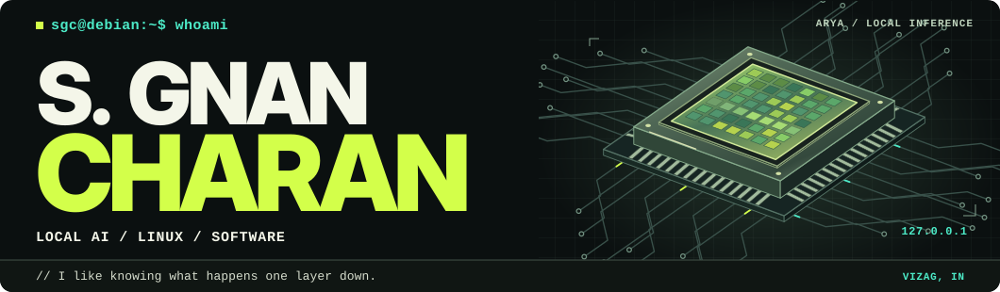
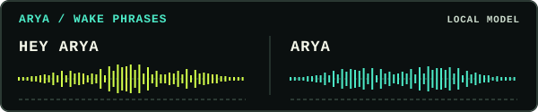
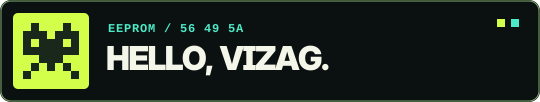

<a name="charan-profile">
  <picture>
    <source media="(max-width: 600px)" srcset="./assets/compute-mobile.svg">
    
  </picture>
</a>

I'm Charan, an AI & ML student at NIAT / NSRIT in Vizag. I run local models, keep a Debian homelab, and like a bug I can reproduce.

[Meet ARYA](#building-arya) · [Explore the projects](#selected-projects) · **[Play the README arcade ↓](#readme-arcade)**

## Building ARYA

**“Hey Arya” or just “Arya.”** My PC listens for both wake phrases so I can call it hands-free, anytime. Behind them is a **27B Qwen 3 model running locally on my RTX 5060 Ti PC**. I wanted my everyday assistant to have a name of its own.

I’m setting up **Home Assistant** to connect ARYA to the appliances around my home. The goal is to control both my PC and the house in one conversation. The command I’m building toward is *“Arya, turn on my desk light and open my project.”*

Inside ARYA · how I want that command to work

| Part of the request | Intended destination |
| --- | --- |
| “Turn on my desk light” | Home Assistant routes the action to the paired light. |
| “Open my project” | The PC opens my workspace so it is ready when I sit down. |

## Selected projects

### MediGuide AI

Two formulations can share a medicine name. My college hackathon prototype asks you to choose the matching record before a local MedGemma model explains it. Telugu is one of **eight language options**. The **79-test suite** covers ambiguous names, language selection and what happens when the model goes offline.

[Source and setup](https://github.com/sgnancharan/Ai-Agent-For-Drug-Indentification) · [Read the integration tests](https://github.com/sgnancharan/Ai-Agent-For-Drug-Indentification/blob/main/tests/end-to-end-integration.test.ts)

### Ganesh: The Quest

Our team built a 2.5D festival game where you assemble a pandal, cook modaks and play dhol in the procession. I worked on the backgrounds with Nikhil, fixed photo mode so it captures the whole scene, and corrected the lighting for the final immersion.

[Festival game demo ↗](https://ganesh-the-quest-game.vercel.app/) · [Source](https://github.com/sgnancharan/ganesh-the-quest) · [My camera and lighting fixes](https://github.com/sgnancharan/ganesh-the-quest/commit/3b5016e370dc5f05d04c16974e407ce48e9fa1f2)

### Little Listen Lab

Give the app a topic and it sends it to a podcast-generation workflow, checks the audio URL it gets back, and plays the episode in the browser. I added a webhook switcher so I can keep using the app when the tunnel address changes. It remembers the new endpoint on my next visit.

[Source and setup](https://github.com/sgnancharan/little-listen-lab) · [Follow a podcast request](https://github.com/sgnancharan/little-listen-lab/blob/main/src/lib/podcast.functions.ts)

<strong>Four more builds · film, hardware, fiction and games</strong>

| Project | What you can do with it |
| --- | --- |
| [MovieStream](https://github.com/sgnancharan/moviestream) | Pick a movie or series by genre and language, see its streaming providers, and keep your watch history for the next movie night. |
| [Onyx Studio Lab](https://github.com/sgnancharan/onyx-studio-lab) | Explore local tech services, from custom PC assembly to home networking. A built-in estimator lets you price out the work. |
| [ORV Character Generator](https://github.com/sgnancharan/orv-character-generator) | Turn your name and photo into an *Omniscient Reader’s Viewpoint* character, draw a sponsor, and save the illustrated card as a PNG. |
| [Jaldi 5](https://github.com/sgnancharan/jaldi-5) | Track tickets, prizes and change owed. When a player wins, the app calculates the cash to hand over and records the payout. |

## README arcade

Open a game below. Clear **one bank, trace or capture per game** to collect its two-digit hex byte. The three bytes unlock the console at the bottom.

<strong>Play Echo Array · memory</strong>

Watch the four pads from **SYNC**. Remember which letters light up, then select them one at a time.

Bank A · 3 keys

Watch the signal

Read the text feed

The keys arrive as **K → H → J**.

Close the signal when you have it. Enter the first key.

<code>H</code>

Key 1 missed. Close this choice and try another key.

<code>J</code>

Key 1 missed. Close this choice and try another key.

<code>K</code>

Key 1 matched. Enter key 2.

<code>H</code>

Key 2 matched. Enter key 3.

<code>H</code>

Key 3 missed. Close this choice and try another key.

<code>J</code>

**Cache hit. Every key matched.** Your console byte is **`56`**.

<code>K</code>

Key 3 missed. Close this choice and try another key.

<code>L</code>

Key 3 missed. Close this choice and try another key.

<code>J</code>

Key 2 missed. Close this choice and try another key.

<code>K</code>

Key 2 missed. Close this choice and try another key.

<code>L</code>

Key 2 missed. Close this choice and try another key.

<code>L</code>

Key 1 missed. Close this choice and try another key.

Bank B · 4 keys

Watch the signal

Read the text feed

The keys arrive as **L → J → J → H**.

Close the signal when you have it. Enter the first key.

<code>H</code>

Key 1 missed. Close this choice and try another key.

<code>J</code>

Key 1 missed. Close this choice and try another key.

<code>K</code>

Key 1 missed. Close this choice and try another key.

<code>L</code>

Key 1 matched. Enter key 2.

<code>H</code>

Key 2 missed. Close this choice and try another key.

<code>J</code>

Key 2 matched. Enter key 3.

<code>H</code>

Key 3 missed. Close this choice and try another key.

<code>J</code>

Key 3 matched. Enter key 4.

<code>H</code>

**Cache hit. Every key matched.** Your console byte is **`56`**.

<code>J</code>

Key 4 missed. Close this choice and try another key.

<code>K</code>

Key 4 missed. Close this choice and try another key.

<code>L</code>

Key 4 missed. Close this choice and try another key.

<code>K</code>

Key 3 missed. Close this choice and try another key.

<code>L</code>

Key 3 missed. Close this choice and try another key.

<code>K</code>

Key 2 missed. Close this choice and try another key.

<code>L</code>

Key 2 missed. Close this choice and try another key.

<strong>Play Clock Edge · timing</strong>

The cursor sweeps across a six-tick bus. Read the register at the instant the cursor crosses **LATCH**, then select that value. Each sweep repeats.

Trace A · normal speed

Step through the text trace

The latch is at tick **4**.

| Tick | 1 | 2 | 3 | 4 | 5 | 6 |
| --- | --- | --- | --- | --- | --- | --- |
| Register | `2D` | `74` | `B1` | `9C` | `4E` | `A7` |

Which value was on the bus at the latch?

<code>0x4E</code>

You sampled tick 5, after the latch. Watch the cursor cross the dashed line and try again.

<code>0x9C</code>

**Clock locked. Register `9C` was on the bus at tick 4.** Your console byte is **`49`**.

<code>0xB1</code>

You sampled tick 3, before the latch. Watch the cursor cross the dashed line and try again.

Trace B · fast scan

Step through the text trace

The latch is at tick **2**.

| Tick | 1 | 2 | 3 | 4 | 5 | 6 |
| --- | --- | --- | --- | --- | --- | --- |
| Register | `03` | `C8` | `62` | `D1` | `57` | `E4` |

Which value was on the bus at the latch?

<code>0x03</code>

You sampled tick 1, before the latch. Watch the cursor cross the dashed line and try again.

<code>0x62</code>

You sampled tick 3, after the latch. Watch the cursor cross the dashed line and try again.

<code>0xC8</code>

**Clock locked. Register `C8` was on the bus at tick 2.** Your console byte is **`49`**.

<strong>Play Parity Patch · debugging</strong>

One bit flipped in transit. Each original byte had an **even** number of ones, and XOR of any two originals gives the third. Find the bad frame, then recover its value.

Capture A

Pick the frame with the flipped bit.

<code>A　1010 0101</code>

This byte has 4 ones. Its parity is even. Check a different frame.

<code>B　0011 1101</code>

Odd parity. To reconstruct frame B, XOR the two good bytes. Which value should replace it?

<code>0x38</code>

That byte fails the cross-check. XOR sets a bit wherever the two good bytes differ.

<code>0x3C</code>

**Frame repaired. XOR returns `0x3C`.** Your console byte is **`5A`**.

<code>0x3D</code>

That byte fails the cross-check. XOR sets a bit wherever the two good bytes differ.

<code>C　1001 1001</code>

This byte has 4 ones. Its parity is even. Check a different frame.

Capture B

Pick the frame with the flipped bit.

<code>A　0110 0110</code>

This byte has 4 ones. Its parity is even. Check a different frame.

<code>B　0101 0101</code>

This byte has 4 ones. Its parity is even. Check a different frame.

<code>C　0010 0011</code>

Odd parity. To reconstruct frame C, XOR the two good bytes. Which value should replace it?

<code>0x32</code>

That byte fails the cross-check. XOR sets a bit wherever the two good bytes differ.

<code>0x33</code>

**Frame repaired. XOR returns `0x33`.** Your console byte is **`5A`**.

<code>0x37</code>

That byte fails the cross-check. XOR sets a bit wherever the two good bytes differ.

<strong>Unlock the console · 3 bytes</strong>

Choose the bytes you collected, in the order the games appear above.

<code>49 56 5A</code>

The order is off. Read the bytes from Echo Array, Clock Edge, then Parity Patch.

<code>56 5A 49</code>

The order is off. Read the bytes from Echo Array, Clock Edge, then Parity Patch.

<code>56 49 5A</code>

**Console unlocked.** Your bytes spell `VIZ` in ASCII. Hello from Visakhapatnam. — Charan

## Homelab and teamwork

I run Jellyfin on Debian and use the same homelab for Docker Swarm and boot-recovery experiments. I was technical lead on our six-person Vertithron team, handling architecture, API integrations and debugging.

[All repositories](https://github.com/sgnancharan?tab=repositories) · [LinkedIn](https://www.linkedin.com/in/s-gnan-charan-994a1b349/) · [Email me](mailto:sgnancharan730@gmail.com)
