<div align="center">

<!-- ══════════════════ DYNAMIC ANIMATED CRIMSON HUD HERO BANNER ══════════════════ -->


<!-- ══════════════════ ACTIVE COMMAND BAR & VISITORS RADAR ══════════════════ -->
[](https://s-gnan-charan-portfolio.vercel.app/)
[](https://github.com/sgnancharan)
[](https://www.linkedin.com/in/s-gnan-charan-994a1b349/)
[](mailto:sgnancharan730@gmail.com)
[](mailto:sgnancharan730@gmail.com)

<br/>

<!-- ══════════════════ DYNAMIC ANIMATED TYPING SVG ══════════════════ -->


<!-- ══════════════════ CLEAN GLOWING DIVIDER ══════════════════ -->


</div>

I'm Charan, an AI & ML student at NIAT / NSRIT in Vizag. I run local models, keep a Debian homelab, and like a bug I can reproduce.

[Meet ARYA](#building-arya) · [Explore the projects](#selected-projects) · [System Architecture](#interactive-system-blueprints) · [Tech Arsenal](#mission-critical-tech-arsenal) · **[Play the README arcade ↓](#readme-arcade)**

```ini
; ── SYSTEM DIAGNOSTIC RUNTIME // HOST: BAREMETAL-SGC ──────────────────────────────────────
[IDENTITY]      OPERATOR   = "S. Gnan Charan" (SGC)
[LOCATION]      COORDS     = "Andhra Pradesh, India // NSRIT / NIAT"
[STATUS]        LIFECYCLE  = "🟢 ACTIVE · OPEN FOR HIGH-IMPACT SOFTWARE & SYSTEMS ROLES"
[SURFACE]       PORTFOLIO  = "https://s-gnan-charan-portfolio.vercel.app/"
[KERNEL]        PRIMARY    = "Debian 13 (Trixie) x86_64 // Custom Systemd Daemons"
[CONTAINERS]    FLEET      = "Docker Swarm · Least-Privilege Isolated Microservices"
[GRAPHICS]      SPATIAL    = "Three.js r174 · WebGL Shaders · GSAP Inertia · Next.js 16"
[TELEMETRY]     MOTTO      = "I don't just consume abstractions — I audit them down to the silicon."
```

<div align="center">

</div>

## ⚡ EXECUTIVE BRIEF: THE UNFAIR ADVANTAGE

> **99% of developers write code for runtimes they don't understand.** They know React components, but panic when a network socket hangs, a kernel panics, or a container volume deadlocks.
>
> **I build the whole loop:** From bare-metal Linux partition tables and Docker Swarm network meshes, all the way up to 120 FPS Three.js spatial simulations in Next.js 16.

* 🚀 **High-FPS Spatial Web Engineering:** Built a production-grade 3D aerospace launch telemetry simulator modeling ISRO’s LVM3 heavy lifter in **Three.js (r174)** and **Next.js 16**, rendering procedural S200 booster stage separation physics, thermal plasma shaders, and dynamic orbital starfields locked at an unflinching 60–120 FPS on [s-gnan-charan-portfolio.vercel.app](https://s-gnan-charan-portfolio.vercel.app/).
* 🖥️ **Bare-Metal & OS Internals:** Battle-tested administration of **Debian 13 Trixie**, MBR/GRUB boot recovery, custom Linux systemd daemons, local storage volume layout, and kernel tuning.
* 🐳 **Container Orchestration & Workload Isolation:** Production-grade deployments using **Docker** and **Docker Swarm** — enforcing strict namespace isolation, least-privilege service boundaries, automated replica self-healing, and zero-trust local network tunneling.
* 🔒 **Air-Gapped Private Edge Intelligence:** Built local-first private AI runtimes (**Ollama / CUDA**) on private hardware for private intelligence and secure multi-agent workflows.

---

## Building ARYA

**“Hey Arya” or just “Arya.”** My PC listens for both wake phrases so I can call it hands-free, anytime. Behind them is a **27B Qwen 3 model running locally on my RTX 5060 Ti PC**. I wanted my everyday assistant to have a name of its own.

I’m setting up **Home Assistant** to connect ARYA to the appliances around my home. The goal is to control both my PC and the house in one conversation. The command I’m building toward is *“Arya, turn on my desk light and open my project.”*

<details>
<summary>Inside ARYA · how I want that command to work</summary>

<br>

| Part of the request | Intended destination |
| --- | --- |
| “Turn on my desk light” | Home Assistant routes the action to the paired light. |
| “Open my project” | The PC opens my workspace so it is ready when I sit down. |

</details>

---

## Selected projects

### MediGuide AI

Two formulations can share a medicine name. My college hackathon prototype asks you to choose the matching record before a local MedGemma model explains it. Telugu is one of **eight language options**. The **79-test suite** covers ambiguous names, language selection and what happens when the model goes offline.

[Source and setup](https://github.com/sgnancharan/Ai-Agent-For-Drug-Indentification) · [Read the integration tests](https://github.com/sgnancharan/Ai-Agent-For-Drug-Indentification/blob/main/tests/end-to-end-integration.test.ts)

### Ganesh: The Quest

Our team built a 2.5D festival game where you assemble a pandal, cook modaks and play dhol in the procession. I worked on the backgrounds with Nikhil, fixed photo mode so it captures the whole scene, and corrected the lighting for the final immersion.

[Festival game demo ↗](https://ganesh-the-quest-game.vercel.app/) · [Source](https://github.com/sgnancharan/ganesh-the-quest) · [My camera and lighting fixes](https://github.com/sgnancharan/ganesh-the-quest/commit/3b5016e370dc5f05d04c16974e407ce48e9fa1f2)

### Little Listen Lab

Give the app a topic and it sends it to a podcast-generation workflow, checks the audio URL it gets back, and plays the episode in the browser. I added a webhook switcher so I can keep using the app when the tunnel address changes. It remembers the new endpoint on my next visit.

[Source and setup](https://github.com/sgnancharan/little-listen-lab) · [Follow a podcast request](https://github.com/sgnancharan/little-listen-lab/blob/main/src/lib/podcast.functions.ts)

<details>
<summary><strong>Four more builds · film, hardware, fiction and games</strong></summary>

<br>

| Project | What you can do with it |
| --- | --- |
| [MovieStream](https://github.com/sgnancharan/moviestream) | Pick a movie or series by genre and language, see its streaming providers, and keep your watch history for the next movie night. |
| [Onyx Studio Lab](https://github.com/sgnancharan/onyx-studio-lab) | Explore local tech services, from custom PC assembly to home networking. A built-in estimator lets you price out the work. |
| [ORV Character Generator](https://github.com/sgnancharan/orv-character-generator) | Turn your name and photo into an *Omniscient Reader’s Viewpoint* character, draw a sponsor, and save the illustrated card as a PNG. |
| [Jaldi 5](https://github.com/sgnancharan/jaldi-5) | Track tickets, prizes and change owed. When a player wins, the app calculates the cash to hand over and records the payout. |

</details>

---

## 🛰️ INTERACTIVE SYSTEM BLUEPRINTS

<details>
<summary><b>▶ [SYS-01] ISRO 3D Spatial Launch Engine & WebGL Shader Pipeline</b></summary>
<br>

```
[Viewport] ────► [Three.js r174 Canvas] ────► [LVM3 Heavy Lifter Procedural Mesh]
                         │
                         ├─► S200 Twin Boosters Lateral Detachment (x ± 4.4 at p ∈ [0.40, 0.65])
                         ├─► Core Vikas Engine Bells Plasma Dive
                         ├─► Inverted-V (0° to 180°) Flame Reveal Geometry Shaders
                         └─► Lenis Smooth Inertia Spline + GSAP lagSmoothing(500, 33) = Silky 120 FPS
```
* **Engine:** Next.js 16, React 19, Three.js r174, GSAP ScrollTrigger, Tailwind CSS v4.
* **Telemetry:** Real-time altitude, velocity ($M/S$), and active S200 + L110 engine thrust gauge with authentic Indian Livery (🇮🇳).
* **Live Surface:** [Explore s-gnan-charan-portfolio.vercel.app](https://s-gnan-charan-portfolio.vercel.app/)
</details>

<details>
<summary><b>▶ [SYS-02] Bare-Metal Debian 13 Trixie & Disaster MBR Recovery Matrix</b></summary>
<br>

```
[BIOS / UEFI] ────► [MBR Sector 0 Stage 1] ────► [GRUB Core / Kernel 6.x] ────► [Debian 13 Trixie Root]
                                                        │
                                                        └─► Custom Systemd Units & Storage DAWs
                                                        └─► Bare-metal Jellyfin Multimedia Node
                                                        └─► Isolated Reverse Proxy & Local Networking
```
* **Focus:** Keeping systems reachable, recoverable, and maintainable under failure scenarios.
* **Core Skills:** Partition table diagnosis, MBR boot sector repair, storage health monitoring, systemd unit orchestration, and zero-downtime maintenance.
</details>

<details>
<summary><b>▶ [SYS-03] Docker Swarm Fleet & Microservices Network Topology</b></summary>
<br>

```
[Incoming Traffic] ────► [Nginx Edge Proxy / SSL Termination]
                                    │
           ┌────────────────────────┴────────────────────────┐
           ▼                                                 ▼
[App Replicas (Worker 1)]                         [App Replicas (Worker 2)]
  ├─ Namespace Isolation                            ├─ Namespace Isolation
  ├─ Ingress Overlay Network                        ├─ Ingress Overlay Network
  └─ Ephemeral Volume Mounts                        └─ Ephemeral Volume Mounts
```
* **Orchestration:** Multi-node service mesh coordination using Docker & Docker Swarm.
* **Reliability:** Automated rolling updates, health checks, CPU/memory quotas, and defensive inter-service access controls.
</details>

<details>
<summary><b>▶ [SYS-04] ARYA // Air-Gapped Local-First Private AI Node</b></summary>
<br>

```
[Client Request] ──(mTLS / Local Only)──► [FastAPI Gateway] ──► [Ollama Runtime / CUDA Engine]
                                                                        │
                                                                 [Quantized LLM]
                                                                 (Zero Cloud Leaks)
```
* **Architecture:** 100% private, local-silicon intelligence hub running over NVIDIA CUDA.
* **Privacy:** Air-gapped network boundary preventing prompt leakage or external telemetry.
</details>

---

## 🛠️ MISSION-CRITICAL TECH ARSENAL

<div align="center">

<!-- Skill Icons Matrix -->
<p>
  
  <br/>
  
</p>

### `LAYER 01 // SYSTEMS, OS & BARE-METAL INFRASTRUCTURE`
[](https://debian.org)
[](https://kernel.org)
[](https://ubuntu.com)
[](https://gnu.org/software/bash)
[](https://github.com/sgnancharan)

### `LAYER 02 // CONTAINERS, CLOUD & ORCHESTRATION`
[](https://docker.com)
[](https://docs.docker.com/engine/swarm/)
[](https://nginx.org)
[](https://git-scm.com)
[](https://github.com)
[](https://vercel.com)

### `LAYER 03 // 3D GRAPHICS, RUNTIMES & FRONTEND ARCHITECTURE`
[](https://nextjs.org)
[](https://react.dev)
[](https://threejs.org)
[](https://www.typescriptlang.org)
[](https://tailwindcss.com)
[](https://gsap.com)

### `LAYER 04 // BACKEND, DATASTORES & LOCAL-FIRST AI`
[](https://nodejs.org)
[](https://python.org)
[](https://ollama.ai)
[](https://developer.nvidia.com/cuda-zone)
[](https://supabase.com)
[](https://firebase.google.com)

</div>

---

## 🛸 FEATURED ENGINEERING ARTIFACTS

| System / Project | Domain & Architecture | Core Tech Stack | Verification / Status |
|:---|:---|:---|:---:|
| **[ISRO 3D Spatial Launch Engine](https://s-gnan-charan-portfolio.vercel.app/)** | **Interactive Orbital Telemetry & 3D WebGL Surface**<br>Autonomous Sriharikota launch sequence featuring real-time LVM3 heavy lifter procedural mechanics, S200 twin booster physics separation, dynamic 180° inverted-V plasma exhaust transitions, Lenis inertia interpolation, and zero-jerk 120 FPS rendering. | `Next.js 16` `Three.js` `React 19` `GSAP` `Tailwind v4` | [⚡ Launch Surface](https://s-gnan-charan-portfolio.vercel.app/) |
| **Bare-Metal Debian & Homelab Cluster** | **Host Infrastructure & Storage Orchestration**<br>Administering bare-metal Debian 13 Trixie clusters running private self-hosted services (Jellyfin multimedia node, reverse proxy routing, disk sector recovery, and automated local volume replication). | `Debian 13` `Linux` `MBR` `Bash` `Jellyfin` | `🟢 Operational` |
| **Swarm Container Fleet** | **Container Isolation & Replica Orchestration**<br>Multi-service cluster architecture orchestrated via Docker & Docker Swarm. Implemented zero-trust service boundaries, least-privilege network segmentation, resource contention profiling, and automated rolling container updates. | `Docker` `Docker Swarm` `Linux IPC` `Nginx` | `🛡️ Deployed` |
| **[ARYA // Private AI Node](https://github.com/sgnancharan)** | **Air-Gapped Edge AI & Automation**<br>Zero-cloud local AI runtime executing quantized Large Language Models on local silicon via CUDA acceleration. Serves as a private, surveillance-free intelligence and home automation command node. | `Python` `Ollama` `CUDA` `Docker` `REST` | `🧪 Lab / Active` |
| **[Jaldi 5 Matrix](https://github.com/sgnancharan/jaldi-5)** | **Distributed Ledger & P2P Debt Settlement**<br>High-concurrency web ledger engineering peer-to-peer balance tracking, state synchronization, and instant multi-party payment reconciliation with transactional data integrity. | `React` `Node.js` `Firebase` `Tailwind` | [⚡ Live](https://github.com/sgnancharan/jaldi-5) |
| **[FlightPool Engine](https://github.com/sgnancharan)** | **Transit Route Optimization & Pooling Algorithm**<br>Algorithmic shared airport transit matching system computing optimal multi-passenger clustering and waypoint distribution to minimize fuel burn and commute latency. | `Algorithms` `Graph Theory` `TypeScript` | `📐 Prototype` |

---

## 📊 LIVE TELEMETRY & CONTRIBUTION RADAR

<div align="center">

<!-- ══════════════════ CONTRIBUTION SNAKE ══════════════════ -->


<br/><br/>

<table border="0">
  <tr>
    <td align="center">
      
    </td>
    <td align="center">
      
    </td>
  </tr>
</table>


</div>

---

## README arcade

Open a game below. Clear **one bank, trace or capture per game** to collect its two-digit hex byte. The three bytes unlock the console at the bottom.

<details>
<summary><strong>Play Echo Array · memory</strong></summary>

<br>

Watch the sequence. Remember which letters light up, then select them one at a time.

<details>
<summary>Bank A · 3 keys</summary>

<br>

> **Signal Feed:** The keys arrive as **K → H → J**.

Enter the first key:

<details>
<summary><code>H</code></summary>

Key 1 missed. Close this choice and try another key.

</details>

<details>
<summary><code>J</code></summary>

Key 1 missed. Close this choice and try another key.

</details>

<details>
<summary><code>K</code></summary>

Key 1 matched. Enter key 2.

<details>
<summary><code>H</code></summary>

Key 2 matched. Enter key 3.

<details>
<summary><code>H</code></summary>

Key 3 missed. Close this choice and try another key.

</details>

<details>
<summary><code>J</code></summary>

**Cache hit. Every key matched.** Your console byte is **`56`**.

</details>

<details>
<summary><code>K</code></summary>

Key 3 missed. Close this choice and try another key.

</details>

<details>
<summary><code>L</code></summary>

Key 3 missed. Close this choice and try another key.

</details>

</details>

<details>
<summary><code>J</code></summary>

Key 2 missed. Close this choice and try another key.

</details>

<details>
<summary><code>K</code></summary>

Key 2 missed. Close this choice and try another key.

</details>

<details>
<summary><code>L</code></summary>

Key 2 missed. Close this choice and try another key.

</details>

</details>

<details>
<summary><code>L</code></summary>

Key 1 missed. Close this choice and try another key.

</details>

</details>

<details>
<summary>Bank B · 4 keys</summary>

<br>

> **Signal Feed:** The keys arrive as **L → J → J → H**.

Enter the first key:

<details>
<summary><code>H</code></summary>

Key 1 missed. Close this choice and try another key.

</details>

<details>
<summary><code>J</code></summary>

Key 1 missed. Close this choice and try another key.

</details>

<details>
<summary><code>K</code></summary>

Key 1 missed. Close this choice and try another key.

</details>

<details>
<summary><code>L</code></summary>

Key 1 matched. Enter key 2.

<details>
<summary><code>H</code></summary>

Key 2 missed. Close this choice and try another key.

</details>

<details>
<summary><code>J</code></summary>

Key 2 matched. Enter key 3.

<details>
<summary><code>H</code></summary>

Key 3 missed. Close this choice and try another key.

</details>

<details>
<summary><code>J</code></summary>

Key 3 matched. Enter key 4.

<details>
<summary><code>H</code></summary>

**Cache hit. Every key matched.** Your console byte is **`56`**.

</details>

<details>
<summary><code>J</code></summary>

Key 4 missed. Close this choice and try another key.

</details>

<details>
<summary><code>K</code></summary>

Key 4 missed. Close this choice and try another key.

</details>

<details>
<summary><code>L</code></summary>

Key 4 missed. Close this choice and try another key.

</details>

</details>

<details>
<summary><code>K</code></summary>

Key 3 missed. Close this choice and try another key.

</details>

<details>
<summary><code>L</code></summary>

Key 3 missed. Close this choice and try another key.

</details>

</details>

<details>
<summary><code>K</code></summary>

Key 2 missed. Close this choice and try another key.

</details>

<details>
<summary><code>L</code></summary>

Key 2 missed. Close this choice and try another key.

</details>

</details>

</details>

</details>

<details>
<summary><strong>Play Clock Edge · timing</strong></summary>

<br>

The cursor sweeps across a six-tick bus. Read the register at the instant the cursor crosses **LATCH**, then select that value.

<details>
<summary>Trace A · normal speed</summary>

<br>

The latch is at tick **4**:

| Tick | 1 | 2 | 3 | 4 | 5 | 6 |
| --- | --- | --- | --- | --- | --- | --- |
| Register | `2D` | `74` | `B1` | `9C` | `4E` | `A7` |

Which value was on the bus at the latch?

<details>
<summary><code>0x4E</code></summary>

You sampled tick 5, after the latch. Watch the cursor cross the dashed line and try again.

</details>

<details>
<summary><code>0x9C</code></summary>

**Clock locked. Register `9C` was on the bus at tick 4.** Your console byte is **`49`**.

</details>

<details>
<summary><code>0xB1</code></summary>

You sampled tick 3, before the latch. Watch the cursor cross the dashed line and try again.

</details>

</details>

<details>
<summary>Trace B · fast scan</summary>

<br>

The latch is at tick **2**:

| Tick | 1 | 2 | 3 | 4 | 5 | 6 |
| --- | --- | --- | --- | --- | --- | --- |
| Register | `03` | `C8` | `62` | `D1` | `57` | `E4` |

Which value was on the bus at the latch?

<details>
<summary><code>0x03</code></summary>

You sampled tick 1, before the latch. Watch the cursor cross the dashed line and try again.

</details>

<details>
<summary><code>0x62</code></summary>

You sampled tick 3, after the latch. Watch the cursor cross the dashed line and try again.

</details>

<details>
<summary><code>0xC8</code></summary>

**Clock locked. Register `C8` was on the bus at tick 2.** Your console byte is **`49`**.

</details>

</details>

</details>

<details>
<summary><strong>Play Parity Patch · debugging</strong></summary>

<br>

One bit flipped in transit. Each original byte had an **even** number of ones, and XOR of any two originals gives the third. Find the bad frame, then recover its value.

<details>
<summary>Capture A</summary>

<br>

Pick the frame with the flipped bit:

<details>
<summary><code>A　1010 0101</code></summary>

This byte has 4 ones. Its parity is even. Check a different frame.

</details>

<details>
<summary><code>B　0011 1101</code></summary>

Odd parity. To reconstruct frame B, XOR the two good bytes. Which value should replace it?

<details>
<summary><code>0x38</code></summary>

That byte fails the cross-check. XOR sets a bit wherever the two good bytes differ.

</details>

<details>
<summary><code>0x3C</code></summary>

**Frame repaired. XOR returns `0x3C`.** Your console byte is **`5A`**.

</details>

<details>
<summary><code>0x3D</code></summary>

That byte fails the cross-check. XOR sets a bit wherever the two good bytes differ.

</details>

</details>

<details>
<summary><code>C　1001 1001</code></summary>

This byte has 4 ones. Its parity is even. Check a different frame.

</details>

</details>

<details>
<summary>Capture B</summary>

<br>

Pick the frame with the flipped bit:

<details>
<summary><code>A　0110 0110</code></summary>

This byte has 4 ones. Its parity is even. Check a different frame.

</details>

<details>
<summary><code>B　0101 0101</code></summary>

This byte has 4 ones. Its parity is even. Check a different frame.

</details>

<details>
<summary><code>C　0010 0011</code></summary>

Odd parity. To reconstruct frame C, XOR the two good bytes. Which value should replace it?

<details>
<summary><code>0x32</code></summary>

That byte fails the cross-check. XOR sets a bit wherever the two good bytes differ.

</details>

<details>
<summary><code>0x33</code></summary>

**Frame repaired. XOR returns `0x33`.** Your console byte is **`5A`**.

</details>

<details>
<summary><code>0x37</code></summary>

That byte fails the cross-check. XOR sets a bit wherever the two good bytes differ.

</details>

</details>

</details>

<details>
<summary><strong>Unlock the console · 3 bytes</strong></summary>

<br>

Choose the bytes you collected, in the order the games appear above:

<details>
<summary><code>49 56 5A</code></summary>

The order is off. Read the bytes from Echo Array, Clock Edge, then Parity Patch.

</details>

<details>
<summary><code>56 5A 49</code></summary>

The order is off. Read the bytes from Echo Array, Clock Edge, then Parity Patch.

</details>

<details>
<summary><code>56 49 5A</code></summary>

<br>

> **CONSOLE STATUS: 0x56 0x49 0x5A [UNLOCKED]**

**Console unlocked.** Your bytes spell `VIZ` in ASCII. Hello from Visakhapatnam. — Charan

</details>

</details>

---

## Homelab and teamwork

I run Jellyfin on Debian and use the same homelab for Docker Swarm and boot-recovery experiments. I was technical lead on our six-person Vertithron team, handling architecture, API integrations and debugging.

[All repositories](https://github.com/sgnancharan?tab=repositories) · [LinkedIn](https://www.linkedin.com/in/s-gnan-charan-994a1b349/) · [Email me](mailto:sgnancharan730@gmail.com)

---

## 🎯 WHAT RECRUITERS & ENGINEERING TEAMS GET ON DAY ONE

> *"Hire engineers who understand the metal, respect the hardware, and build frontends that feel like science fiction."*

```
┌──[ OPERATIONAL CAPABILITIES ]────────────────────────────────────────────────────────┐
│                                                                                      │
│  01. ZERO HANDHOLDING VELOCITY                                                       │
│      └─ Give me an ambiguous problem, an RFC, or failing infrastructure.             │
│         I isolate root causes, engineer solutions, benchmark, and ship.             │
│                                                                                      │
│  02. FULL-SPECTRUM ARCHITECTURAL FLUENCY                                             │
│      └─ I don't stop at API contracts. I care about thread contention, packet        │
│         travel times, memory allocations, and container replica health.              │
│                                                                                      │
│  03. RELENTLESS PERFORMANCE STANDARDS                                                │
│      └─ Whether profiling a WebGL rendering loop or tuning Linux kernel parameters,  │
│         dropped frames and unhandled edge cases are not tolerated.                   │
│                                                                                      │
│  04. PRODUCTION-READY INTEGRITY                                                      │
│      └─ Clean atomic commits, clear architectural diagrams, defensive error traps,   │
│         and maintainable, self-documenting codebases.                                │
│                                                                                      │
└──────────────────────────────────────────────────────────────────────────────────────┘
```

---

## 📡 DIRECT DISPATCH // RECRUITMENT COMMS

I am actively engaging with forward-thinking engineering teams, high-growth startups, and technical leadership who value engineers that can build across the full stack and dive deep into systems infrastructure.

<div align="center">

[](mailto:sgnancharan730@gmail.com)
[](https://www.linkedin.com/in/s-gnan-charan-994a1b349/)
[](https://s-gnan-charan-portfolio.vercel.app/)

<br/>


<!-- ══════════════════ ANIMATED DARK CRIMSON FOOTER ══════════════════ -->


</div>
